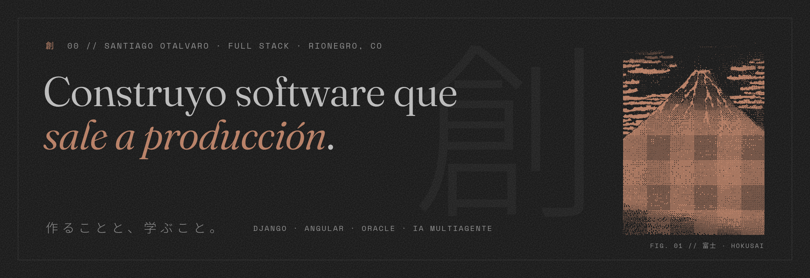

<picture>
  <source media="(prefers-color-scheme: light)" srcset="assets/banner-light.png">
  
</picture>

  <a href="https://santiago-0t.github.io/"><code>santiago-0t.github.io ↗</code></a>&nbsp;
  <a href="https://www.linkedin.com/in/santiago-otalvaro-539349403/"><code>linkedin ↗</code></a>&nbsp;
  <a href="mailto:santig0talvaro@gmail.com"><code>correo ↗</code></a>&nbsp;
  <a href="https://santiago-0t.github.io/cv-santiago-otalvaro.pdf"><code>cv.pdf ↗</code></a>

Soy desarrollador full stack en formación (Tecnología en Análisis y Desarrollo de Software, SENA) y practicante de desarrollo de software en la **Universidad Católica de Oriente**, en Rionegro, Antioquia. Migro sistemas heredados a **Django + Angular sobre Oracle y PostgreSQL**, los llevo a producción y trabajo a diario con flujos de **múltiples agentes de IA** dentro del ciclo de desarrollo.

| `250+` | `~5.000` | `16` | `4.º` |
|:--|:--|:--|:--|
| pull requests integrados | inscripciones al año en el sistema que migré | versiones de la norma de desarrollo en dos meses | puesto nacional en semilleros de investigación 2026 |

---

### `01 //` 作 Proyectos

> Mi trabajo en la universidad vive en su repositorio interno; aquí lo describo sin publicar su código. Git Flow y Conventional Commits en todo.

| Proyecto | Qué hice | Impacto |
|---|---|---|
| **SIEPCI** · inscripciones del Centro de Idiomas y Educación Permanente | Migración de PowerBuilder a Django + Angular sobre Oracle en producción: personas, catálogo, calificaciones y facturación | Proceso de ~5.000 inscripciones al año; 535 usuarios vinculados y 116 con rol |
| **SIEventos** · eventos de pago | Creé el proyecto y lo llevé a producción con Oracle, pago en línea y Docker Compose | 6 eventos, 67 inscripciones, 43 pagos en línea |
| **SIBE** · Bienestar y Evangelización | Migración de Java a Django + Angular 21 en 9 fases, ensayo de corte sobre copia de producción, Microsoft Entra ID | Rediseño accesible (WCAG AA) |
| **Inscripciones Académico** · portal del aspirante | Portal y panel administrativo en PrimeNG con tema institucional | Pruebas automáticas de contraste AA |
| **EVE** · unificación de sistemas de eventos | Arquitectura, modelo de datos y backend de eventos gratuitos | En desarrollo |
| **Lineamientos de desarrollo de software** | Impulsé la norma y soy su principal contribuidor (más del 50 % de los cambios) | Adoptada por 18 proyectos, el equipo de sistemas y ~10 proyectos externos |

**機 Linux para agentes.** Impulso la migración de los equipos de desarrollo de Windows/WSL a Linux para trabajar con varios agentes de IA en paralelo, algo que WSL limitaba.

---

### `02 //` 研 Investigación

- **LuxSense: sistema inteligente de automatización de iluminación con machine learning para optimización energética en instituciones educativas.** *Revista CienciometriK*, 4(6), 23–27, 2026. ISSN 2981-5533. Autor principal. Sensores IoT, análisis exploratorio y regresión lineal; reducción estimada de 12 a 18 t de CO₂ al año por sede. [`leer artículo ↗`](https://drive.google.com/file/d/1Tw17IZYcgMOUj2GJ3l3n4tSb70sNP0Ea/view?usp=drive_link)
- `4.º` Encuentros Zonales de Semilleros de Investigación 2026 · evento nacional, Montería.
- `2.º` Feria regional de investigación · 2025.
- `★` Mejor proyecto de grado en nuevas tecnologías · 2025.

---

### `03 //` 道 Stack

`→` Me gradúo como tecnólogo en marzo de 2027.

---

### `04 //` 結 Contacto

¿Un proyecto, una vacante o una idea? Escríbame a **santig0talvaro@gmail.com** o visite [`santiago-0t.github.io`](https://santiago-0t.github.io/).

Arte: Katsushika Hokusai, *Viento del sur, cielo despejado* («Fuji rojo», c. 1830–32), dominio público; recortado y tramado.
