<a href="https://santiago-0t.github.io/"><picture><source media="(prefers-color-scheme: light)" srcset="assets/banner-light.png"></picture></a>

  
  
  
  
  

> [!NOTE]
> Soy desarrollador full stack en formación (Tecnología en Análisis y Desarrollo de Software, SENA) y practicante de desarrollo de software en la **Universidad Católica de Oriente**, en Rionegro, Antioquia. Migro sistemas heredados a **Django + Angular sobre Oracle y PostgreSQL**, los llevo a producción y trabajo a diario con flujos de **múltiples agentes de IA** dentro del ciclo de desarrollo.

<picture><source media="(prefers-color-scheme: light)" srcset="assets/stats-light.png">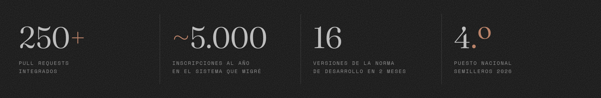</picture>

<picture><source media="(prefers-color-scheme: light)" srcset="assets/sec-01-light.png">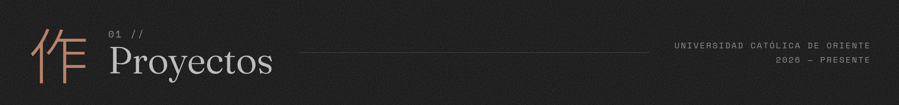</picture>

  <a href="https://santiago-0t.github.io/#proyectos"><picture><source media="(prefers-color-scheme: light)" srcset="assets/card-01-light.png">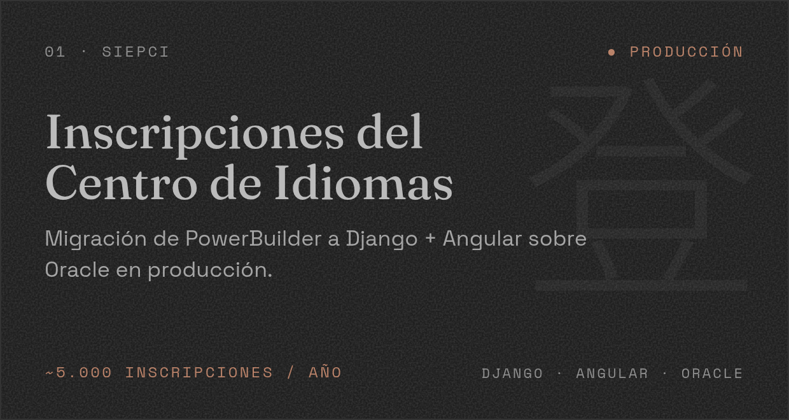</picture></a>
  <a href="https://santiago-0t.github.io/#proyectos"><picture><source media="(prefers-color-scheme: light)" srcset="assets/card-02-light.png">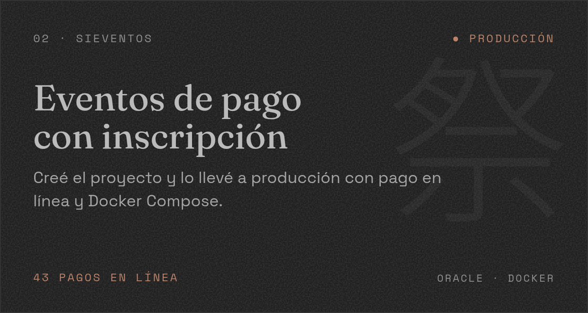</picture></a>

  <a href="https://santiago-0t.github.io/#proyectos"><picture><source media="(prefers-color-scheme: light)" srcset="assets/card-03-light.png">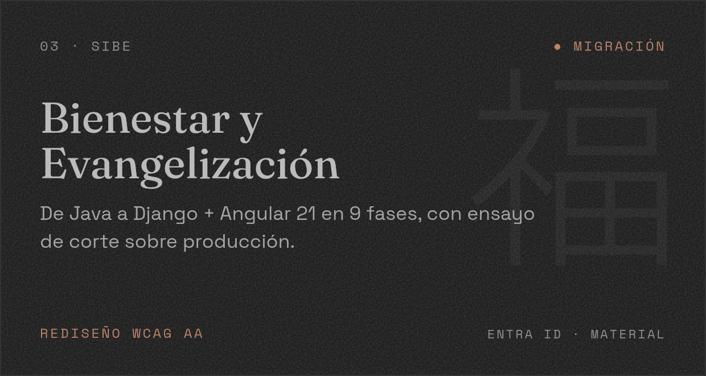</picture></a>
  <a href="https://santiago-0t.github.io/#proyectos"><picture><source media="(prefers-color-scheme: light)" srcset="assets/card-04-light.png">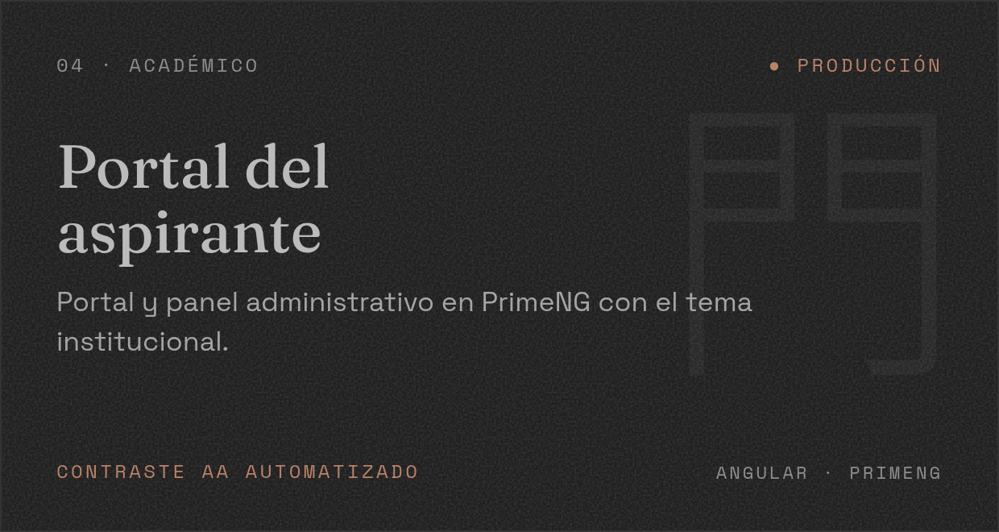</picture></a>

  <a href="https://santiago-0t.github.io/#proyectos"><picture><source media="(prefers-color-scheme: light)" srcset="assets/card-05-light.png">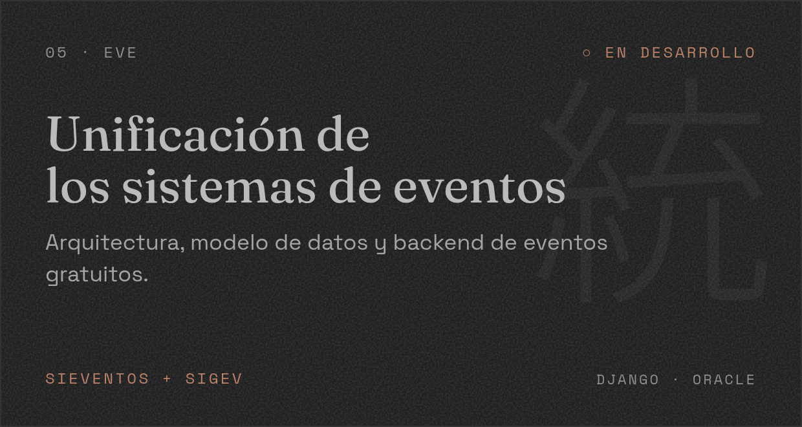</picture></a>
  <a href="https://santiago-0t.github.io/#proyectos"><picture><source media="(prefers-color-scheme: light)" srcset="assets/card-06-light.png">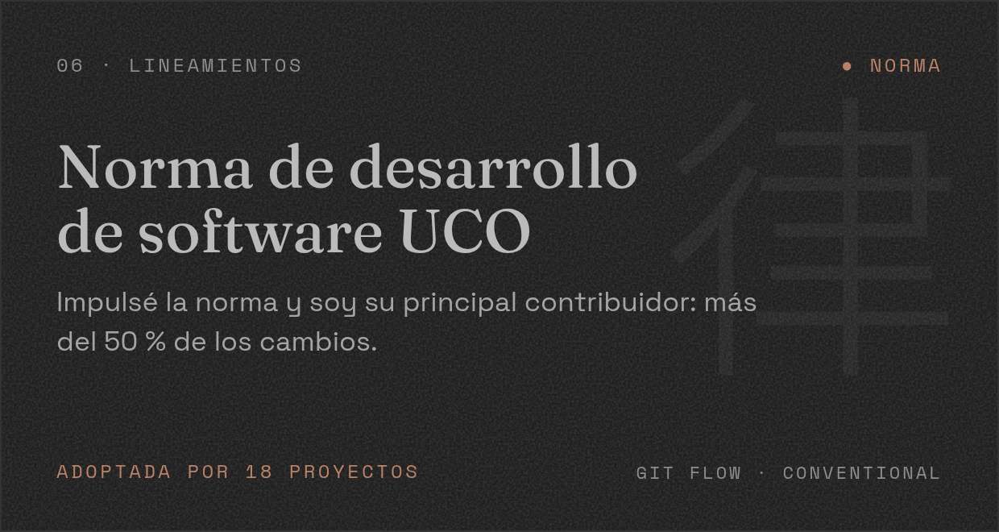</picture></a>

<a href="https://github.com/Santiago-0t/kazari"><picture><source media="(prefers-color-scheme: light)" srcset="assets/card-07-light.png">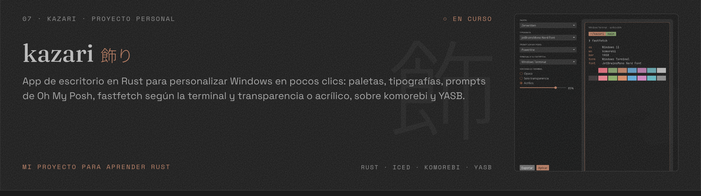</picture></a>

Mi trabajo en la universidad vive en su repositorio interno; aquí lo describo sin publicar su código. Git Flow y Conventional Commits en todo.

> [!TIP]
> **機 Linux para agentes.** Impulso la migración de los equipos de desarrollo de Windows/WSL a Linux para trabajar con varios agentes de IA en paralelo, algo que WSL limitaba.

<picture><source media="(prefers-color-scheme: light)" srcset="assets/sec-02-light.png">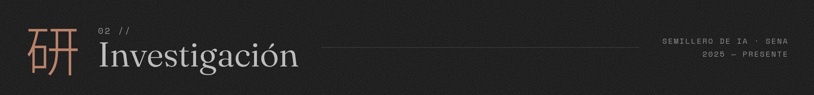</picture>

<table>
<tr>
<td width="72%" valign="top">

**`PUBLICACIÓN · 2026`**

### LuxSense
Sistema inteligente de automatización de iluminación con machine learning para optimización energética en instituciones educativas.

*Revista CienciometriK*, 4(6), 23–27 · ISSN 2981-5533 · **autor principal** · [ORCID](https://orcid.org/0009-0007-8591-3085)

Sensores IoT, análisis exploratorio y regresión lineal: reducción estimada de **12 a 18 t de CO₂ al año** por sede.

Plataforma web del proyecto en TypeScript: predicción y control del consumo energético con IoT. Soy su principal contribuidor.

[`leer artículo ↗`](https://drive.google.com/file/d/1Tw17IZYcgMOUj2GJ3l3n4tSb70sNP0Ea/view?usp=drive_link) &nbsp; [`ver código ↗`](https://github.com/zodiakoCEO/LuxSenseProject)

</td>
<td width="28%" valign="top">

**`RECONOCIMIENTOS`**

`4.º` Encuentros Zonales de Semilleros 2026 · nacional, Montería

`2.º` Feria regional de investigación · 2025

`★` Mejor proyecto de grado en nuevas tecnologías · 2025

</td>
</tr>
</table>

<picture><source media="(prefers-color-scheme: light)" srcset="assets/sec-03-light.png">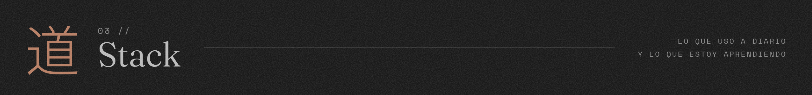</picture>

           

`→` Me gradúo como tecnólogo en marzo de 2027.

<a href="mailto:santig0talvaro@gmail.com"><picture><source media="(prefers-color-scheme: light)" srcset="assets/contact-light.png">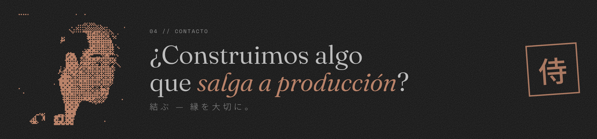</picture></a>

Arte: Katsushika Hokusai, *Viento del sur, cielo despejado* («Fuji rojo», c. 1830–32), y Tōshūsai Sharaku, *Onoe Matsusuke como rōnin* (1794); dominio público, recortados y tramados.
